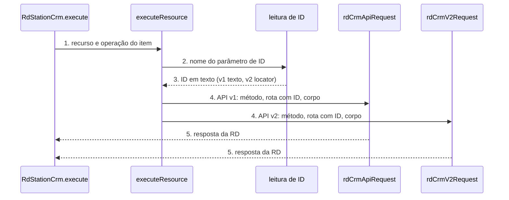

# RD Station CRM: node-cli 0.55 e campos guiados (versão 2 do node)

**Approved**: 2026-11-06 - user: "Aprovo os três (Recomendado · Jev 0,94)"

> Build this with **tlc-implement**. Every criterion becomes a check with a proof; nothing under
> the open questions is settled while building.

## Problem

O pacote `n8n-nodes-rd-station-crm` 2.3.2 compila com `tsc` + `gulp` e passa num plugin de lint antigo (`@n8n/eslint-plugin-community-nodes` 0.23). O `n8n-node lint` do `@n8n/node-cli` 0.55.5, que a guideline de verificação do n8n exige, acusa 121 erros neste código (86 corrigíveis por `--fix`): texto de descrição sem ponto final, `any` explícito e um `catch` vazio no trigger.

Quem preenche o node digita à mão o ID de cerca de 20 campos (contato, negócio, empresa, tarefa, funil, etapa, produto, fonte, campanha, motivo de perda, campo personalizado, time, usuário, webhook). Para achar o ID, a pessoa sai do n8n e procura no RD. A UX guideline do n8n manda usar Resource Locator com `From list` como padrão. O pacote não tem nenhum teste automatizado.

Quando isso sair: o lint oficial passa sem erro, e em node novo cada campo de ID mostra uma lista pesquisável vinda da conta, com a opção de colar o ID. Workflows salvos continuam funcionando sem nenhuma edição.

## Shape

Reutiliza os `loadOptions` e os transportes (`rdCrmApiRequest`, `rdCrmV2Request`) que já existem; os modos de lista do Resource Locator chamam as mesmas rotas de listagem. A regra que muda o resultado, ler o ID do campo na versão 1 (texto) ou na versão 2 (Resource Locator), fica numa função única de leitura de ID chamada pelo `execute` de cada recurso, que os testes alcançam pelo `execute` do node.

1. entra o item do workflow -> `RdStationCrm.execute` (exists) - lê `resource` e `operation`, chama `executeResource`
2. `executeResource` (exists) - despacha para `execute<Recurso>` do recurso
3. leitura de ID (new) - na versão 1 lê o texto do parâmetro; na versão 2 lê `value` do Resource Locator; os dois devolvem o mesmo texto
4. `rdCrmApiRequest` / `rdCrmV2Request` (exists) - monta a requisição com o ID e chama `httpRequestWithAuthentication`
5. out: a resposta da RD como itens do n8n, igual à 2.3.2

**Changes underneath**

| Front | What changes |
| --- | --- |
| domain | nada: os recursos e as operações não mudam |
| stored data | nothing to migrate: workflows salvos guardam `typeVersion` 1 e continuam lendo os parâmetros em texto |
| readers | o editor do n8n mostra a versão 2 só em node novo |
| toolchain | `package.json`, `eslint.config.mjs`, `tsconfig.json`, `gulpfile.js` e o CI passam para o padrão do template do node-cli 0.55.5 |

Data: none - o node não guarda dado; ele só repassa a requisição para a RD e devolve a resposta.

New: nothing - read only.

## Surface

| Route | In | Out | Status | Who |
| --- | --- | --- | --- | --- |
| node `rdStationCrm` versão 2 | campos de ID como Resource Locator `{ mode, value } com mode list ou id` | a mesma resposta da versão 1 | `200`; `401` da RD com credencial inválida vira `NodeApiError`; demais `4xx` e `5xx` também | quem tem credencial RD válida; sem ela a RD devolve `401` |
| node `rdStationCrm` versão 1 | campos de ID em texto, iguais à 2.3.2 | igual à 2.3.2 | `200`; `401` da RD com credencial inválida vira `NodeApiError`; demais `4xx` e `5xx` também | workflows salvos com credencial RD válida; sem ela a RD devolve `401` |
| `listSearch` de cada campo | texto de busca e página | `{ results: [{ name, value }], paginationToken? }` | `200`; `401` da RD com credencial inválida vira `NodeApiError` | o editor do n8n com credencial RD válida; sem ela a RD devolve `401` |

## Landing

| One-way door | Literal shape | Alternative rejected |
| --- | --- | --- |
| versão do node | `version: [1, 2]`, `defaultVersion: 2`; os campos novos com `displayOptions.show['@version']: [{ _cnd: { gte: 2 } }]` e os antigos com `[1]` | `VersionedNodeType` (versão completa): a guia `.agents/versioning.md` do node-cli proíbe sem reescrita |
| nome dos parâmetros na versão 2 | o mesmo `name` da versão 1 (ex.: `contactId`), só o `type` muda para `resourceLocator` | nome novo (ex.: `contact`): obrigaria mapear dois nomes em cada operação |
| versão do pacote | `2.4.0` (Jev 0,75 contra `3.0.0`) | `3.0.0`: nenhum workflow salvo quebra |

- Nothing else in this change is hard to reverse

## Criteria

### S1: toolchain do node-cli 0.55.5 (P1)

O pacote compila, passa no lint oficial e roda os testes com os comandos do template.

**Acceptance Criteria**

1. WHEN `npm run build` roda THEN o sistema SHALL sair com código 0 e gerar `dist/nodes/RdStationCrm/RdStationCrm.node.js`, `dist/nodes/RdStationCrmTrigger/RdStationCrmTrigger.node.js`, as duas credenciais em `dist/credentials/` e os ícones `.svg` ao lado de cada node
2. WHEN `npm run lint` roda THEN `n8n-node lint` SHALL sair com código 0 e imprimir 0 erros
3. The `package.json` SHALL ter `"build": "n8n-node build"`, `"lint": "n8n-node lint"`, `"n8n.strict": true`, `@n8n/node-cli` `0.55.5` em `devDependencies`, nenhum campo `dependencies` e nenhuma referência a `gulp`
4. WHEN um Pull Request abre THEN o workflow de CI do repositório (arquivo ci.yml em .github/workflows) SHALL rodar `npm ci`, `npm run lint`, `npm test` e `npm run build`
5. WHEN `npm test` roda THEN o sistema SHALL compilar e rodar `node --test test/*.test.cjs` com saída `# fail 0`

### S2: versão 1 continua igual (P1)

Workflow salvo na versão 1 envia exatamente a mesma requisição da 2.3.2.

**Acceptance Criteria**

1. WHEN o `execute` roda com `typeVersion` 1, `resource` `contact`, `operation` `get` e `contactId` `'abc123'` THEN o sistema SHALL chamar GET na rota /contacts/abc123 da base https://crm.rdstation.com/api/v1 com a credencial `rdStationCrmApi`
2. WHEN o `execute` roda com `typeVersion` 1, `resource` `deal`, `operation` `moveToStage`, `dealId` `'d1'` e `dealStageId` `'s9'` THEN o sistema SHALL chamar `PUT /deals/d1` com corpo `{ "deal_stage_id": "s9" }`
3. The node SHALL listar, para `@version` 1, todo parâmetro com o mesmo `name` e o mesmo `type` da 2.3.2

### S3: campos de ID guiados na versão 2 (P1)

Em node novo, cada campo de ID principal é um Resource Locator com lista pesquisável e modo ID.

**Acceptance Criteria**

1. WHEN alguém adiciona o node a um workflow novo THEN o sistema SHALL criá-lo com `typeVersion` 2
2. The node SHALL expor, para `@version` 2, como `resourceLocator` com modos `list` (padrão, `searchable: true`) e `id`, os parâmetros: `contactId`, `dealId`, `organizationId`, `taskId`, `pipelineId`, `stageId`, `productId`, `sourceId`, `campaignId`, `lossReasonId`, `customFieldId`, `teamId`, `userId` (recurso User), `webhookId`, e o `dealId` de Note, Task e Deal Product, nas operações da API v1 e da API v2 onde cada um existe
3. WHEN o `execute` roda com `typeVersion` 2, `contactId` `{ mode: 'list', value: 'abc123' }` THEN o sistema SHALL chamar `GET /contacts/abc123`
4. WHEN o `execute` roda com `typeVersion` 2, `contactId` `{ mode: 'id', value: ' abc123 ' }` THEN o sistema SHALL chamar `GET /contacts/abc123` (espaço nas pontas removido)
5. IF o Resource Locator chega com `value` vazio THEN o sistema SHALL lançar `NodeOperationError` com a mensagem `The 'Contact' parameter is empty [item 0]` e a descrição `Choose a contact from the list or paste its ID`
6. WHEN o editor pede a lista de um campo com texto de busca `ana` THEN o `listSearch` SHALL devolver `{ results: [{ name, value }] }` com o nome legível e o ID da RD, filtrando pelo texto quando a rota da RD aceita filtro e no próprio node quando não aceita

### S4: lançamento 2.4.0 (P2)

A versão nova chega ao npm com provenance.

**Acceptance Criteria**

1. The `package.json` SHALL ter `"version": "2.4.0"` e o `CHANGELOG.md` SHALL ter a seção `## 2.4.0` listando a migração, a versão 2 do node e a correção do lint
2. WHEN a tag `v2.4.0` chega ao GitHub THEN o workflow de publicação (arquivo publish.yml) SHALL publicar `n8n-nodes-rd-station-crm@2.4.0` no npm com provenance, e `npm view n8n-nodes-rd-station-crm version` SHALL devolver `2.4.0`

## Out of scope

| Excluded | Why |
| --- | --- |
| Parâmetro `Simplify` na saída | O pedido é sobre o preenchimento dos campos, não sobre a saída |
| Novas operações ou recursos do CRM | O pedido não pediu; as APIs novas vão para pacotes próprios (AD-001) |
| RD Station Marketing e Conversas | Pacotes e repositórios próprios, com planos próprios (AD-001) |
| Mudar o trigger além do lint | O trigger não tem campo de ID; só o `catch` vazio muda para logar o erro |

## Assumptions

| Assumption | Chosen default | Rationale | Confirmed? |
| --- | --- | --- | --- |
| Campos que já são dropdown (`options` com `loadOptionsMethod`, ex.: etapa, usuário dono) | Ficam como estão nas duas versões | Já são guiados; virar Resource Locator só mudaria o formato sem ganho visível | n |
| Busca do `listSearch` quando a rota da RD não filtra por nome | Carrega a lista e filtra no node pelo texto, sem diferenciar acento | Mantém a lista pesquisável em todo campo | n |
| Mensagens e rótulos do node | Continuam em inglês, como hoje e como o resto do n8n | A UX guideline do n8n escreve em inglês e o pacote já é assim | n |
| Workflow de publicação | Mantém o publish.yml atual (tag `v*`, `npm publish --provenance`) | Já publicou a 2.3.2 com provenance; o template pede o mesmo requisito | n |

**Open questions:** none - all resolved or logged above.

## Differences from the source

None - the product matches the source

## Sources

- Pedido do dono, 06/11/2026: "preciso atualizar e melhorar todos os nodes n8n de acordo com a nova versao, tb quero deixar mias facil e intuitivo o preenchimento dos campos lembrese de sempre consultar a docs da ferramente do node" - binding - escopo do trabalho
- Template e guias `.agents/` do `@n8n/node-cli` 0.55.5 (`versioning.md`, `properties.md`, `nodes.md`, `workflow.md`) - binding - toolchain, versão leve, Resource Locator
- n8n UX guidelines (`docs/connect/create-nodes/build-your-node/reference/ux-guidelines.md` no repositório `n8n-io/n8n-docs`) - binding - `From list` como padrão, Title Case, mensagens de erro
- Guideline de verificação do n8n (`verification-guidelines.md`) - binding - `n8n-node`, um serviço por pacote, sem dependência de runtime
