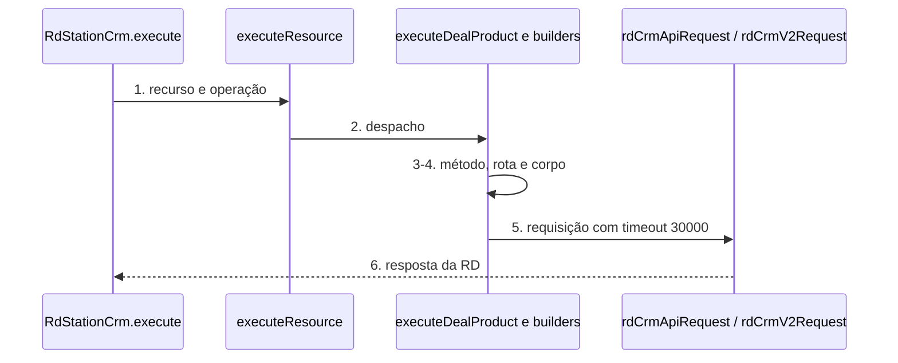

# RD Station CRM: correção da rota em lote da v1, três rotas novas e campos novos

**Approved**: 2026-11-06 - user: "implementa as rotas novas de todos"

> Build this with **tlc-implement**. Every criterion becomes a check with a proof; nothing under
> the open questions is settled while building.

## Problem

O node `n8n-nodes-rd-station-crm` 2.4.0 chama, na API v1, `PUT /deals/{id}/deal_products/batch` para atualizar e `DELETE /deals/{id}/deal_products/batch` com `{product_ids}` para remover produtos da negociação. A documentação oficial da v1 (páginas `crm-v1-update-products-from-deal` e `crm-v1-delete-products-from-deal`, atualizadas em 10/06/2026) descreve outra rota e outro corpo: `PATCH .../batch/update` com `{deal_products:[{id,amount,price}]}` e `DELETE .../batch/destroy` com `{deal_products:[{id}]}`. Quem usa Update ou Remove em Deal Product depende de uma rota que a doc não descreve.

Além disso, a doc v1 tem três rotas de produto da negociação que o node não cobre (criar um, atualizar um, remover um), e o node não envia campos graváveis que a doc lista: `legal_bases` no contato, `distribution_settings` na negociação (v1 e v2), `social_profiles` no contato v2, seis campos no campo personalizado v2 e `address` e `follower_ids` na empresa v2.

Quando isso sair: Update e Remove de produtos da negociação usam a rota da doc, três operações novas existem em Deal Product, e os campos novos aparecem como opcionais nas operações já cobertas.

## Shape

Reutiliza `rdCrmApiRequest` e `rdCrmV2Request` (já com timeout de 30 s) e os construtores de corpo de cada recurso; nenhum módulo novo. As regras que mudam a requisição (rota, método, corpo) rodam no `execute` de cada recurso, que os testes alcançam pelo `execute` do node compilado.

1. entra o item do workflow -> `RdStationCrm.execute` (exists) - lê `resource` e `operation`
2. `executeResource` (exists) - despacha para `executeDealProduct`, `executeContact`, `executeDeal` e os `*V2`
3. `executeDealProduct` (exists) - monta método, rota e corpo da operação
4. `buildContactBody`, `executeDeal`, `buildContactV2Body`, `buildDealV2Body`, `buildOrganizationV2Body` e o construtor de campo personalizado v2 (exists) - acrescentam os campos opcionais ao corpo
5. `rdCrmApiRequest` / `rdCrmV2Request` (exists) - enviam com `timeout` 30000
6. out: a resposta da RD como itens do n8n

**Changes underneath**

| Front | What changes |
| --- | --- |
| domain | nada muda de significado: Update e Remove de Deal Product continuam fazendo o mesmo, só a requisição muda |
| stored data | nothing to migrate: nomes e tipos de parâmetro ficam iguais; workflows salvos continuam válidos |
| readers | o editor mostra três operações novas e campos opcionais novos; quem já usa Update e Remove passa a enviar a rota da doc |

Data: none - o node não guarda dado; repassa a requisição para a RD.

New: nothing - read only.

## Surface

| Route | In | Out | Status | Who |
| --- | --- | --- | --- | --- |
| `PATCH /deals/{deal_id}/deal_products/batch/update` | `{deal_products:[{id,amount,price}]}` | `{deal:{deal_products:[...]}}` | `204`/`200`; `400`, `404`, `413` (mais de 100), `422` | token v1 válido; sem ele `401` |
| `DELETE /deals/{deal_id}/deal_products/batch/destroy` | `{deal_products:[{id}]}` | `{deal:{...}}` | `200`; `400`, `404`, `413` | token v1 válido; sem ele `401` |
| `POST /deals/{deal_id}/deal_products` | `{product_id,amount,price,discount,discount_type,recurrence}` | o produto criado | `201`, `401` sem token | token v1 válido; sem ele `401` |
| `PUT /deals/{deal_id}/deal_products/{deal_product_id}` | os mesmos campos | o produto atualizado | `200`, `401` sem token | token v1 válido; sem ele `401` |
| `DELETE /deals/{deal_id}/deal_products/{deal_product_id}` | nada | corpo vazio | `204`, `401` sem token | token v1 válido; sem ele `401` |

## Landing

| One-way door | Literal shape | Alternative rejected |
| --- | --- | --- |
| valor das operações novas | `addOne`, `updateOne`, `removeOne` no recurso `dealProduct`; o `value` vira contrato com workflows salvos | `create`/`delete`: colidiria em significado com o `add`/`remove` em lote que já existem |
| nome dos campos novos | `legalBasesUi`, `distributionSettings`, e as chaves de `additionalFields`/`updateFields` com o nome da doc em camelCase | reutilizar nome existente: mudaria parâmetro já salvo |
| versão do pacote | `2.5.0` (MINOR, aditiva) | `2.4.1`: entram operações e campos novos |

- Nothing else in this change is hard to reverse

## Criteria

### S1: rota em lote da v1 segue a doc (P1)

Update e Remove em lote de Deal Product enviam a rota e o corpo da doc.

**Acceptance Criteria**

1. WHEN o `execute` roda com `resource` `dealProduct`, `operation` `update`, `dealId` `d1` e uma linha `{id:'P1', amount:2, price:15.1}` THEN o sistema SHALL chamar `PATCH /deals/d1/deal_products/batch/update` com corpo `{deal_products:[{id:'P1', amount:2, price:15.1}]}`
   - o corpo não carrega `product_id`, `discount`, `discount_type`, `recurrence` nem `total` quando a linha não os preenche → só `id`, `amount`, `price`
2. WHEN o `execute` roda com `operation` `remove`, `dealId` `d1` e ids `P1` e `P2` THEN o sistema SHALL chamar `DELETE /deals/d1/deal_products/batch/destroy` com corpo `{deal_products:[{id:'P1'},{id:'P2'}]}` e devolver `{deleted:true}`
3. The node SHALL manter, para as operações `add`, `update`, `remove`, `getMany`, o mesmo `name` e o mesmo `type` de todo parâmetro da 2.4.0 (comparação das propriedades visíveis de `origin/master`)

### S2: três operações novas em Deal Product (P2)

**Acceptance Criteria**

1. WHEN o `execute` roda com `operation` `addOne`, `dealId` `d1`, `product_id` `PR1`, `amount` 3.1, `price` 150, `discount` 50, `discount_type` `value`, `recurrence` `spare` THEN o sistema SHALL chamar `POST /deals/d1/deal_products` com esse corpo
2. WHEN o `execute` roda com `operation` `updateOne`, `dealId` `d1`, `dealProductId` `DP9` e `price` 500 THEN o sistema SHALL chamar `PUT /deals/d1/deal_products/DP9` com corpo `{price:500}`
3. WHEN o `execute` roda com `operation` `removeOne`, `dealId` `d1` e `dealProductId` `DP9` THEN o sistema SHALL chamar `DELETE /deals/d1/deal_products/DP9` sem corpo e devolver `{deleted:true}`
4. IF `dealProductId` chega vazio em `updateOne` ou `removeOne` THEN o sistema SHALL lançar `NodeOperationError` antes de qualquer requisição
5. The node SHALL enviar `timeout` 30000 nas três requisições

### S3: campos novos da v1 (P2)

**Acceptance Criteria**

1. WHEN o `execute` roda com `resource` `contact`, `operation` `create` e `legalBasesUi` com `{category:'data_processing', type:'consent', status:'granted'}` THEN o sistema SHALL enviar em `POST /contacts` o corpo `contact.legal_bases:[{category:'data_processing', type:'consent', status:'granted'}]`; o mesmo vale para `update` em `PUT /contacts/{id}`
2. WHEN o `execute` roda com `resource` `deal`, `operation` `create` e `distributionOwnerType` `team`, `distributionOwnerId` `T1` THEN o sistema SHALL enviar em `POST /deals` o corpo `distribution_settings:{owner:{type:'team', id:'T1'}}`; com `distributionOwnerEmail` `a@b.com` o corpo leva `owner.email`
3. WHEN nenhum campo novo é preenchido THEN o corpo SHALL ser idêntico ao da 2.4.0 (sem `legal_bases` nem `distribution_settings`)

### S4: campos novos da v2 (P2)

**Acceptance Criteria**

1. WHEN o contato v2 é criado ou atualizado com `socialProfilesUi` `[{type:'linkedin', username:'maria'}]` e `legalBasesUi` `[{category:'communications', type:'consent', status:'granted'}]` THEN o sistema SHALL enviar `data.social_profiles` e `data.legal_bases` com esses valores
2. WHEN o campo personalizado v2 é criado ou atualizado com `application_scope` `selected`, `product_ids` `P1,P2`, `calculation_action` `add`, `editable_on_deal` true THEN o sistema SHALL enviar `data.application_scope`, `data.product_ids:['P1','P2']`, `data.calculation_action` e `data.editable_on_deal`
3. WHEN o campo personalizado v2 recebe `displayRulesUi` `[{property:'deal_pipeline_id', value:'PL1', always:false}]` e `requiredRulesUi` equivalente THEN o sistema SHALL enviar `data.display_rules` e `data.required_rules` com `property`, `value` e `always`
4. WHEN a negociação v2 recebe `distribution_stage_id` `S1`, `distribution_rule_type` `user`, `distribution_rule_id` `U1` THEN o sistema SHALL enviar `data.distribution_settings:{stage_id:'S1', rule:{type:'user', id:'U1'}}`
5. WHEN a empresa v2 recebe `address_line` `Rua A 1`, `address_latitude` `-23.5`, `address_longitude` `-46.6` e `follower_ids` `U1,U2` THEN o sistema SHALL enviar `data.address:{line, latitude, longitude}` e `data.follower_ids:['U1','U2']`
6. WHEN nenhum campo novo é preenchido THEN o corpo SHALL ser idêntico ao da 2.4.0

### S5: lançamento 2.5.0 (P3)

**Acceptance Criteria**

1. The `package.json` SHALL ter `"version": "2.5.0"` e o `CHANGELOG.md` SHALL ter a seção `## 2.5.0` com a correção de rota, as operações novas e os campos novos
2. The `.specs/STATE.md` SHALL registrar a decisão AD-007 da correção de rota
3. WHEN `npm run lint`, `npm test`, `npx tsc --noEmit` e `npm run build` rodam THEN cada um SHALL sair com código 0

## Out of scope

| Excluded | Why |
| --- | --- |
| `GET /token/check` como operação | A credencial `rdStationCrmApi` já valida o token em `/token/check` (`credentials/RdStationCrmApi.credentials.ts`); operação nova só duplicaria. Jev 0,47 para teste de credencial |
| Resource Locator para o ID do produto da negociação | A listagem existe só por negociação (`/deals/{id}/deal_products`); os campos de ID do lote já são texto. Ficam em texto |
| Rotas v2 novas (leads, funis, webhooks v2 etc.) | Pertencem à outra frente, no worktree da v2 |
| Valores fixos para `category`/`type`/`status` de `legal_bases` na v1 | A doc v1 só dá exemplos (`data_processing`, `consent`, `granted`); campo de texto livre |

## Assumptions

| Assumption | Chosen default | Rationale | Confirmed? |
| --- | --- | --- | --- |
| Corpo de `update` em lote: só `id`, `amount`, `price` | O node envia só esses três campos da linha | O schema da doc lista só eles; o node hoje enviava campos que a doc não descreve | n |
| Resposta `204` do PATCH em lote | Devolve o que `rdCrmApiRequest` devolver, sem tratamento extra | Já é como o node trata o `add` em lote | n |
| A API real ainda aceita a rota antiga | Não testado contra a API; vale a doc | Sem token em mãos; a doc é a fonte | n |
| Remover um produto da negociação não é destrutivo em massa | Sem campo de confirmação | Afeta um item; a regra de confirmação cobre apagar em massa | n |

**Open questions:** none - all resolved or logged above.

## Differences from the source

None - the product matches the source

## Sources

- Pedido do orquestrador, 06/11/2026: fatias v1 + correções + campos novos - binding - escopo
- Auditoria `auditoria-rdcrm.md` (06/11/2026) - binding - lista de rotas e campos
- Docs oficiais `crm-v1-update-products-from-deal`, `crm-v1-delete-products-from-deal`, `crm-v1-create-product-to-deal`, `crm-v1-update-product-from-deal`, `crm-v1-delete-product-from-deal`, `crm-v1-create-contact`, `crm-v1-create-deal`, `crm-v2-create-contact`, `crm-v2-create-custom-field`, `crm-v2-create-deal`, `crm-v2-create-organization` (developers.rdstation.com/reference/<slug>.md, 06/11/2026) - binding - rotas, corpos e campos
