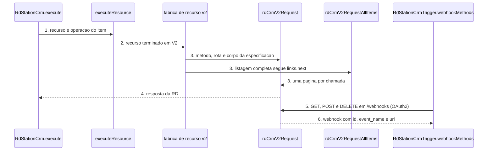

# RD Station CRM: rotas novas da API v2 e trigger OAuth2

**Approved**: 2026-11-06 - user: "implementa as rotas novas de todos"

> Build this with **tlc-implement**. Every criterion becomes a check with a proof; nothing under
> the open questions is settled while building.

## Problem

A API v2 do RD Station CRM documenta 83 operações (OpenAPI de cada página `crm-v2-*` em `developers.rdstation.com`). O node cobre 23 delas, em 6 recursos (contato, campo personalizado, negociação, anotação, empresa, tarefa). Quem usa OAuth2 não consegue, pelo n8n, criar nem ler leads, funis, etapas, fontes, motivos de perda, usuários, equipes, produtos, campanhas, reuniões, propostas, segmentos, anexos da negociação, ligações do webphone, nem os produtos de uma negociação; precisa chamar a API à mão com o node HTTP Request.

O trigger registra webhooks só pela API v1 (token), com 23 eventos. A v2 documenta 38 eventos (a OpenAPI do `POST /webhooks` lista 38 valores em `event_name`), entre eles os de lead, reunião, proposta, ligação e `crm_task_deleted`. Quem usa OAuth2 não recebe esses eventos.

Quando isso sair: com a credencial OAuth2, o node oferece as 60 operações v2 que faltam, os campos de ID ligados a elas mostram uma lista da conta, e o trigger aceita OAuth2 com os 38 eventos. Workflows salvos (token, v1; node versão 1 e 2) continuam iguais.

## Shape

Reutiliza o transporte `rdCrmV2Request` (envelope `{ data }`, timeout de 30 s, credencial `rdStationCrmOAuth2Api`), o `rdCrmV2RequestAllItems` (paginação por `links.next`), o `getIdParameter` e o `withGuidedIds` (Resource Locator) e os `loadOptionsV2` que já existem. As regras que mudam o resultado (qual rota e qual corpo cada operação envia, e qual webhook o trigger cria ou apaga) rodam nos `execute` e `webhookMethods` do dist, que os testes alcançam pelo `execute` do node e pelo `webhookMethods` do trigger.

1. entra o item do workflow -> `RdStationCrm.execute` (exists) - lê `resource` e `operation`
2. `executeResource` (exists) - despacha pelo `resource`; os recursos novos terminam em `V2`
3. fábrica de recurso v2 (new) - a partir de uma especificação declarativa (caminho, campos, operações), monta as propriedades da tela e o `execute` do recurso; recursos com corpo especial (anexos, propostas) têm função própria
4. `rdCrmV2Request` / `rdCrmV2RequestAllItems` (exists) - envia a requisição com `{ data: corpo }`
5. trigger: `webhookMethods.default` (exists) - com `authentication = oauth2`, `checkExists`, `create` e `delete` falam com `/webhooks` da v2, procurando pela URL do modo atual
6. out: a resposta da RD como itens do n8n; o trigger emite o corpo recebido (`event_name`, `event_timestamp`, `transaction_uuid`, `document`)

**Changes underneath**

| Front | What changes |
| --- | --- |
| domain | recursos e operações novos só aparecem com Authentication = OAuth2; os da v1 e os 6 da v2 não mudam |
| stored data | nothing to migrate: workflows salvos não têm os recursos novos |
| readers | o editor mostra os recursos novos no menu Resource da API v2; o trigger ganha o campo Authentication (padrão Access Token) |
| trigger | `authentication` novo com padrão `accessToken`; o parâmetro `events` (v1) fica igual; os eventos v2 vivem em `eventsV2`, visível só com OAuth2 |

Data: none - o node não guarda dado; o trigger guarda só os `id` dos webhooks que ele criou, por URL, no static data do workflow.

New: nothing - read only.

## Surface

| Route | In | Out | Status | Who |
| --- | --- | --- | --- | --- |
| node `rdStationCrm`, recursos `leadV2`, `pipelineV2`, `stageV2`, `sourceV2`, `lostReasonV2`, `userV2`, `teamV2`, `dealProductV2`, `webhookV2`, `productV2`, `campaignV2`, `meetingV2`, `proposalV2`, `segmentV2`, `dealFileV2`, `dialerCallV2` | parâmetros de cada operação, ID como Resource Locator na versão 2 do node | corpo `data` da RD | `200`/`201`/`204`; `401` com credencial inválida e demais `4xx`/`5xx` viram `NodeApiError` | quem tem credencial OAuth2 RD válida e plano Basic, Pro ou Advanced; sem a credencial a RD devolve `401` |
| trigger `rdStationCrmTrigger` com OAuth2 | `eventsV2` (lista dos 38 eventos) | item com o corpo que a RD envia | o endpoint do n8n responde `200` ao receber; sem a credencial OAuth2 válida a RD devolve `401` na criação do webhook | a RD, na URL pública do webhook do n8n; a credencial OAuth2 vale para criar e apagar |

## Landing

| One-way door | Literal shape | Alternative rejected |
| --- | --- | --- |
| nomes dos parâmetros do trigger | `authentication` (padrão `accessToken`) novo, `events` intacto, `eventsV2` novo; versão do trigger continua `1` | mudar o formato de `events` e criar versão 2 do trigger: nenhum parâmetro existente muda de formato, então a versão leve não é necessária (AD-003) |
| chave do static data do trigger v2 | `webhooksV2[<url do webhook>] = [{ id, event }]`, uma entrada por URL (produção e teste coexistem) | uma lista única: um modo apagaria o webhook do outro modo |
| valor dos recursos no menu | `<recurso>V2` (ex.: `leadV2`), igual ao padrão de `contactV2` | nome sem sufixo: colide com os recursos da v1 que aparecem com Access Token |

- Nothing else in this change is hard to reverse

## Criteria

### S1: leads, funis, etapas, fontes, motivos de perda, usuários e produtos da negociação (P1)

Com OAuth2 o node cria, lê e atualiza leads, lê funis, etapas, fontes, motivos de perda e usuários, e gerencia os produtos de uma negociação. A fábrica de recurso v2 nasce nesta fatia.

**Acceptance Criteria**

1. WHEN `resource` `leadV2`, `operation` `create`, `name` `'Ana'` e `additionalFields` `{ status: 'ongoing', rating: 3, contact_ids: 'c1, c2' }` THEN o sistema SHALL chamar `POST /leads` na base da API v2 (`api.rd.services/crm/v2`) com a credencial `rdStationCrmOAuth2Api`, `timeout` 30000 e corpo `{ data: { name: 'Ana', status: 'ongoing', rating: 3, contact_ids: ['c1', 'c2'] } }`
2. WHEN `leadV2` `get` com `leadId` `{ mode: 'id', value: ' L9 ' }` THEN o sistema SHALL chamar `GET /leads/L9`
3. WHEN `leadV2` `update` com `leadId` `L9` e `updateFields` `{ status: 'converted' }` THEN o sistema SHALL chamar `PUT /leads/L9` com corpo `{ data: { status: 'converted' } }`
4. WHEN `leadV2` `getMany` com `returnAll` falso, `limit` 20 e filtro `status:ongoing` THEN o sistema SHALL chamar `GET /leads` com `qs` `{ filter: 'status:ongoing', 'page[size]': 20 }`
5. WHEN `pipelineV2` `get` com `pipelineId` `P1` THEN o sistema SHALL chamar `GET /pipelines/P1`, e `getMany` SHALL chamar `GET /pipelines`
6. WHEN `stageV2` `getMany` com `pipelineId` `P1` THEN o sistema SHALL chamar `GET /pipelines/P1/stages`, e `get` com `stageId` `S2` SHALL chamar `GET /pipelines/P1/stages/S2`
7. WHEN `sourceV2` e `lostReasonV2` rodam `get` e `getMany` THEN o sistema SHALL chamar `GET /sources/{id}`, `GET /sources`, `GET /lost_reasons/{id}` e `GET /lost_reasons`
8. WHEN `userV2` roda `get` com `userId` `U1` e `getMany` THEN o sistema SHALL chamar `GET /users/U1` e `GET /users`
9. WHEN `dealProductV2` `create` com `dealId` `D1`, `productId` `PR1`, `price` 10, `quantity` 2, `discount_type` `percentage`, `discount` 5 e `billing_frequency` `monthly` THEN o sistema SHALL chamar `POST /deals/D1/products` com esse corpo dentro de `data`
10. WHEN `dealProductV2` `getMany` com `dealId` `D1`, `update` com `dealProductId` `X1` e `delete` com `dealProductId` `X1` THEN o sistema SHALL chamar `GET /deals/D1/products`, `PUT /deals/D1/products/X1` e `DELETE /deals/D1/products/X1`
11. The node SHALL expor, para `@version` 2, como `resourceLocator` com modos `list` (padrão) e `id`, os parâmetros `leadId`, `pipelineId`, `stageId`, `sourceId`, `lossReasonId`, `userId` e `dealProductId` dos recursos novos, com listas `searchLeadsV2`, `searchPipelinesV2`, `searchStagesV2`, `searchSourcesV2`, `searchLossReasonsV2` e `searchUsersV2`
12. IF o Resource Locator de `leadId` chega vazio THEN o sistema SHALL lançar `NodeOperationError` com a mensagem `The 'Lead' parameter is empty [item 0]`
13. The node SHALL manter, para as operações que já existiam, o mesmo `name` e o mesmo `type` de todo parâmetro nas versões 1 e 2 (comparação com `origin/master`)

### S2: webhooks v2 e trigger OAuth2 (P1)

O trigger aceita OAuth2 com os 38 eventos da v2 e cria e apaga o webhook pela API v2, sem mexer no webhook de outra URL.

**Acceptance Criteria**

1. WHEN `webhookV2` `create` com `event_name` `crm_lead_created` e `url` `x.test/h` THEN o sistema SHALL chamar `POST /webhooks` com corpo `{ data: { event_name: 'crm_lead_created', http_method: 'POST', url: 'x.test/h' } }`, e com `auth_header` `X-Key` e `auth_key` `k` SHALL enviá-los também
2. WHEN `webhookV2` roda `get`, `getMany`, `update` e `delete` com `webhookId` `W1` THEN o sistema SHALL chamar `GET /webhooks/W1`, `GET /webhooks`, `PUT /webhooks/W1` e `DELETE /webhooks/W1`
3. The trigger SHALL listar em `eventsV2` os 38 valores de `event_name` da OpenAPI, entre eles `crm_lead_created`, `crm_meeting_status_changed`, `crm_proposal_created`, `crm_dialer_call_transcription_completed` e `crm_task_deleted`
4. The trigger SHALL declarar a credencial `rdStationCrmApi` para `authentication` `accessToken` e `rdStationCrmOAuth2Api` para `oauth2`, com `authentication` padrão `accessToken`, e SHALL manter `events` com os mesmos 23 valores e o mesmo `type`
5. WHEN o workflow é ativado com `authentication` `oauth2`, `eventsV2` `[crm_lead_created, crm_lead_updated]` e a RD lista só o webhook `{ id: 'A', event_name: 'crm_lead_created', url: 'U' }` da URL `U` THEN `create` SHALL chamar `POST /webhooks` só para `crm_lead_updated` e guardar `webhooksV2['U']` com os ids `A` e o novo
6. WHEN `checkExists` roda e a RD lista, além dos webhooks da URL `U`, um webhook `{ id: 'Z', url: 'OUTRA' }` THEN o sistema SHALL NÃO chamar `DELETE /webhooks/Z`, em nenhuma circunstância
7. WHEN `checkExists` encontra na URL `U` um webhook cujo evento saiu da seleção, ou um repetido do mesmo evento THEN o sistema SHALL apagá-lo por `DELETE /webhooks/{id}` e SHALL devolver `false` se faltar algum evento selecionado e `true` se todos existirem
8. WHEN `delete` roda THEN o sistema SHALL apagar só os ids guardados em `webhooksV2[<url deste modo>]`, tratar `404` como já apagado, e manter o id guardado se a RD devolver outro erro
9. WHEN o trigger roda com `authentication` `accessToken` e os 23 eventos v1 THEN o sistema SHALL chamar as mesmas rotas e corpos de hoje (`GET /webhooks`, `POST /webhooks` com `event_type`, `DELETE /webhooks/{id}` na base v1)
10. WHEN a RD entrega o corpo `{ event_name, event_timestamp, transaction_uuid, document }` THEN o trigger SHALL emitir um item com esse objeto

### S3: criar e atualizar funis, etapas, fontes e motivos; produtos, campanhas, reuniões, propostas e equipes (P2)

**Acceptance Criteria**

1. WHEN `pipelineV2` `create` com `name` `'Vendas'` e `order` 1 THEN o sistema SHALL chamar `POST /pipelines` com `{ data: { name: 'Vendas', order: 1 } }`, e `update` com `pipelineId` `P1` SHALL chamar `PUT /pipelines/P1`
2. WHEN `stageV2` `create` com `pipelineId` `P1`, `name` `'Proposta'`, `description` `'d'`, `objective` `'o'` e `order` 2 THEN o sistema SHALL chamar `POST /pipelines/P1/stages`, e `update` com `stageId` `S2` SHALL chamar `PUT /pipelines/P1/stages/S2`
3. WHEN `sourceV2` roda `create` com `name` `'Feira'` e `description` `'x'` e `update` THEN o sistema SHALL chamar `POST /sources` e `PUT /sources/{id}` com esses campos; `lostReasonV2` `create` e `update` SHALL chamar `POST /lost_reasons` e `PUT /lost_reasons/{id}` com `{ name }`
4. WHEN `productV2` roda `create` (`name`, `description`, `price` 9.5, `visible` true), `get`, `getMany` e `update` THEN o sistema SHALL chamar `POST /products`, `GET /products/{id}`, `GET /products` e `PUT /products/{id}`
5. WHEN `campaignV2` roda `create` (`name`, `description`), `get`, `getMany` e `update` THEN o sistema SHALL chamar `POST /campaigns`, `GET /campaigns/{id}`, `GET /campaigns` e `PUT /campaigns/{id}`
6. WHEN `meetingV2` `create` com `subject` `'Demo'`, `starts_at` `2026-12-01T10:00:00Z`, `duration_minutes` 30, `status` `scheduled` e `contact_ids` `'c1'` THEN o sistema SHALL chamar `POST /meetings` com `starts_at` em ISO 8601 UTC e `contact_ids` `['c1']`; `get`, `getMany` e `update` SHALL chamar `GET /meetings/{id}`, `GET /meetings` e `PUT /meetings/{id}`
7. WHEN `proposalV2` `create` com `dealId` `D1`, `proposal_template_id` `T1` e `sections` em JSON `[{"slug":"a","type":"html","value":"x","order":1}]` THEN o sistema SHALL chamar `POST /deals/D1/proposals` com esses campos; `getMany` e `get` SHALL chamar `GET /deals/D1/proposals` e `GET /deals/D1/proposals/{id}`
8. IF `sections` do `proposalV2` `create` não é um JSON de lista THEN o sistema SHALL lançar `NodeOperationError` antes de qualquer requisição
9. WHEN `teamV2` roda `get` e `getMany` THEN o sistema SHALL chamar `GET /teams/{id}` e `GET /teams`
10. The node SHALL expor `meetingId`, `campaignId`, `productId` e `teamId` dos recursos novos como Resource Locator na versão 2, com `searchMeetingsV2`, `searchCampaignsV2`, `searchProductsV2` e `searchTeamsV2`

### S4: segmentos, anexos, disponibilidade e ligações (P3)

**Acceptance Criteria**

1. WHEN `segmentV2` roda `create` (`name`), `get`, `getMany` e `update` THEN o sistema SHALL chamar `POST /segments`, `GET /segments/{id}`, `GET /segments` e `PUT /segments/{id}`
2. WHEN `dealFileV2` `getMany` com `dealId` `D1` e `delete` com `fileId` `F1` THEN o sistema SHALL chamar `GET /deals/D1/files` e `DELETE /deals/D1/files/F1`
3. WHEN `dealFileV2` `upload` com `dealId` `D1` e um campo binário com arquivo THEN o sistema SHALL chamar `POST /deals/D1/files` com `multipart/form-data`, o arquivo no campo `data[file]`, e `timeout` 30000
4. IF `dealFileV2` `upload` não encontra o campo binário no item THEN o sistema SHALL lançar `NodeOperationError` antes de qualquer requisição
5. WHEN `userV2` roda `getMeetingAvailability` com `userId` `U1` e `getManyMeetingAvailabilities` THEN o sistema SHALL chamar `GET /users/U1/meeting_availability` e `GET /users/meeting_availability`
6. WHEN `dialerCallV2` roda `get` com `dialerCallId` `C1` e `getMany` THEN o sistema SHALL chamar `GET /dialer_calls/C1` e `GET /dialer_calls`

### S5: lançamento (P2)

**Acceptance Criteria**

1. The `CHANGELOG.md` SHALL ter na seção `## 2.5.0` as rotas novas da API v2 e o trigger OAuth2
2. The `README.md` SHALL listar, na seção da API v2, os recursos e as operações novas e, na seção do Trigger, a autenticação OAuth2 com os 38 eventos
3. WHEN `npm run lint`, `npm test`, `npx tsc --noEmit` e `npm run build` rodam THEN cada um SHALL sair com código 0

## Out of scope

| Excluded | Why |
| --- | --- |
| Mudar a versão em `package.json` | O bump para 2.5.0 é do plano da API v1 (outro subagente); esta branch só escreve na seção `## 2.5.0` do CHANGELOG |
| `sort` e `page` nas listagens novas | O pedido é cobertura de rota; a paginação interna segue `links.next` e o filtro RDQL cobre a seleção |
| Campos novos em rotas v2 já cobertas (`legal_bases`, `social_profiles`, `address`, `distribution_settings`) | A auditoria os lista como lacuna de campo, não de rota; a doc não descreve `distribution_settings` |
| `DELETE` de lead, contato, negociação, empresa e tarefa | A OpenAPI v2 não tem essas rotas |
| Rotas v1 novas (`PATCH batch/update` e outras) | Plano da API v1 |

## Assumptions

| Assumption | Chosen default | Rationale | Confirmed? |
| --- | --- | --- | --- |
| Número de eventos v2 | 38, os da OpenAPI de `POST /webhooks` | A auditoria disse 40; a OpenAPI e as 38 páginas `crm-v2-webhook-event-*` batem em 38 | n |
| Apagar um item (produto da negociação, anexo, webhook) | Sem campo de confirmação: é uma remoção unitária de um ID escolhido, não em massa | O brief pede confirmação para apagar em massa, projeto ou integração em lote | n |
| Trigger OAuth2 e versão do trigger | Sem versão nova: `authentication` é parâmetro novo com padrão `accessToken` e nenhum parâmetro existente muda | AD-003 só pede versão leve quando o formato de um parâmetro muda | n |
| Corpo de `POST /deals/{id}/proposals` | `sections` é JSON digitado pela pessoa | A OpenAPI traz seções com `properties.layout` e `columns` aninhados; um campo JSON evita inventar a estrutura | n |
| `deal_product_custom_fields` e `custom_fields` de produto | Campo JSON | A doc traz `custom_field_id`/`value` sem enum | n |
| Mensagens e rótulos do node | Em inglês | UX guideline do n8n | n |

**Open questions:** none - all resolved or logged above.

## Differences from the source

None - the product matches the source

## Sources

- Pedido do dono, 06/11/2026: "implementa as rotas novas de todos" - binding - escopo do trabalho
- Auditoria `auditoria-rdcrm.md` (06/11/2026) e brief `brief-rotas-novas.md` - binding - lista de rotas e prioridades
- Doc oficial RD Station CRM API v2, páginas `https://developers.rdstation.com/reference/crm-v2-*.md` (OpenAPI de cada rota, lida em 06/11/2026) - binding - método, caminho, corpo e eventos
- `.specs/STATE.md` AD-003 (versão leve) - binding - compatibilidade
